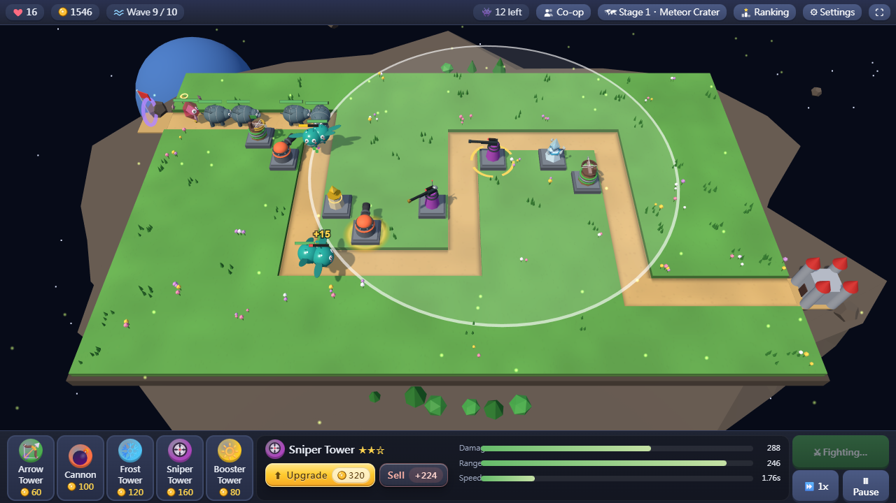
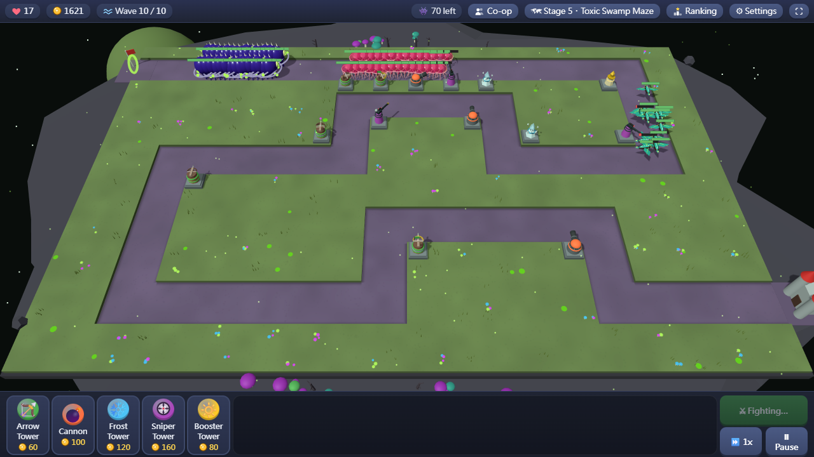

# Tower Asteroid 塔防小行星

A 3D tower defense game that runs right in your browser — no download, no sign-up.

**▶ Play now:** [GitHub Pages](https://m9921039-ctrl.github.io/tower-asteroid-play/) · [itch.io](https://milojan.itch.io/tower-asteroid)

Monsters march along winding roads toward your castle. Build towers beside the road to stop them. Survive 10 waves to clear a map, then move on to the next one.

- **5 maps** that get harder as you go: Meteor Crater, Ring Corridor, Grand Canyon, Dune Highway and Toxic Swamp Maze
- **5 towers**: Arrow, Cannon, Frost, Sniper and Booster, each upgradable to Lv.3
- **Online 2-player co-op**: create a room, share the 5-character code, defend together (peer-to-peer)
- **Global leaderboard**: the lives you have left on each map are your score, 100 points for a perfect run
- **4 languages**: English, 繁體中文, 简体中文, 日本語 (follows your browser, changeable in ⚙ Settings)
- Works with mouse or touch; press `F` for fullscreen

## Controls

| Input | Action |
|---|---|
| Pick a tower below, then click the grass | Build (hold `Shift` to keep building) |
| Click a tower | Upgrade or sell |
| `1` – `5` | Choose a tower type |
| `Space` | Start the next wave |
| `U` / `P` / `Esc` | Upgrade / pause / deselect |
| `F` | Fullscreen |

---

一款打開瀏覽器就能玩的 3D 塔防遊戲。敵人沿著蜿蜒的道路進攻城堡，在路旁蓋防禦塔擋住他們；每張地圖撐過 10 波就過關。五張地圖、五種塔、線上雙人合作、全球積分排行，支援繁中、简中、English、日本語。

**▶ 開始玩：** [GitHub Pages](https://m9921039-ctrl.github.io/tower-asteroid-play/) · [itch.io](https://milojan.itch.io/tower-asteroid)

Made with HTML5, JavaScript and [three.js](https://threejs.org/).

## License

© 2026 MiloJan. All rights reserved. This repository only hosts the playable build. It is **not** open source: you are welcome to play the game, but you may not copy, modify, redistribute or re-host it without permission. See [LICENSE.txt](LICENSE.txt).

本遊戲歡迎免費遊玩，但不是開放原始碼，作者保留所有權利；未經許可不得重製、修改、散布或轉載。
